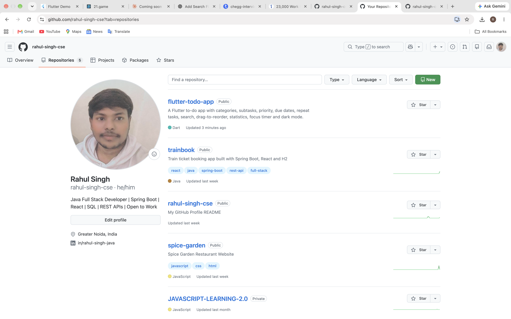

# Flutter To-Do App

A feature-rich to-do app built with Flutter. Tasks are saved on the device, so they stay even after the app is closed.

## Features

- Add, edit and delete tasks (swipe to delete, with undo)
- Subtasks (checklist) and notes
- Categories: Kaam, Ghar, Padhai, Personal
- Priority levels (Low, Medium, High) with colour flags
- Due dates with quick Aaj / Kal buttons and overdue highlighting
- Repeat tasks: daily, weekly, monthly
- Search, sort (date, priority) and filter (all, pending, done)
- Drag to reorder tasks
- Progress bar and statistics sheet
- Focus timer (Pomodoro: 15, 25, 45 minutes)
- Dark mode and 6 theme colours
- Backup and restore of all tasks
- Local storage using shared_preferences

## Tech Stack

- Flutter
- Dart
- shared_preferences

## Getting Started

Make sure Flutter is installed, then run:

```bash
git clone https://github.com/rahul-singh-cse/flutter-todo-app.git
cd flutter-todo-app
flutter pub get
flutter run
```

## Project Structure

```
lib/
  main.dart    # app code (models, pages, widgets)
```

## What I Learned

- State management with setState and ValueNotifier
- Local data persistence with shared_preferences and JSON
- Building responsive UI with Material 3 widgets
- Working with bottom sheets, dialogs, swipe gestures and reorderable lists

## Author

Rahul Singh
[GitHub](https://github.com/rahul-singh-cse)